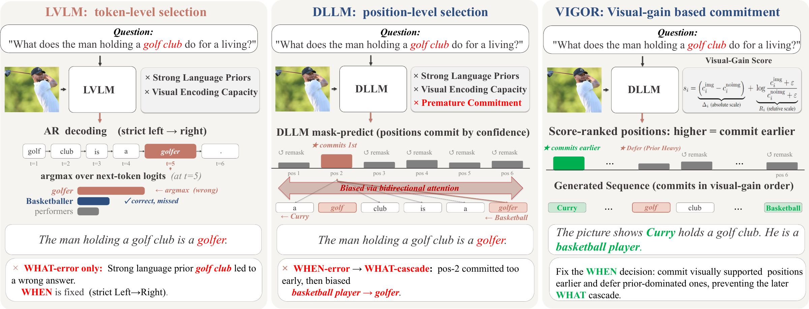
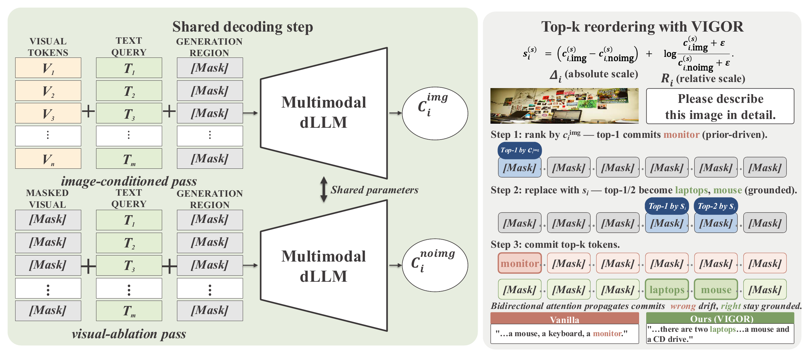

<div align="center">

# VIGOR: Visual Gain Ordering for Hallucination Mitigation in Multimodal Discrete Diffusion Language Models

[](https://neurips.cc/Conferences/2026)

**Junzhe Chen**<sup>1\*</sup>, **Tian Qin**<sup>1,2\*</sup>, Eugenie Shi<sup>3</sup>, Tianshu Zhang<sup>1</sup>, Qiang Ju<sup>4</sup>, Lijie Wen<sup>1†</sup>

<sup>1</sup>Tsinghua University &nbsp; <sup>2</sup>The University of Sydney &nbsp; <sup>3</sup>Stanford University &nbsp; <sup>4</sup>Baichuan AI

<sup>\*</sup>Equal contribution &nbsp; <sup>†</sup>Corresponding author

</div>

## 📢 News

- 🎉 VIGOR has been accepted to **NeurIPS 2026**!

## 📖 Overview

Multimodal discrete diffusion language models (dLLMs) generate responses through iterative mask prediction and offer a promising alternative to autoregressive large vision-language models. However, they still suffer from hallucination, producing outputs that are plausible under language priors but insufficiently grounded in the image.

We argue that hallucination in multimodal dLLMs is not only a token prediction problem, but also a **premature commitment** problem: during iterative denoising, some masked positions are unmasked too early because their confidence is driven more by language priors than by visual evidence, and these early commitments can bias later generation.

<p align="center">
  
</p>
<p align="center"><em>Comparison of hallucination mechanisms in autoregressive LVLMs, multimodal dLLMs, and VIGOR.</em></p>

## 🔍 Method

We propose **Vi**sual **G**ain **Or**dering (**VIGOR**), a **training-free** and **plug-and-play** inference strategy that reorders masked positions according to counterfactual visual evidence. At each denoising step, VIGOR compares the confidence of each candidate token under the original image-conditioned pass and an additional visual-ablation pass, and prioritizes positions whose predictions are more strongly supported by the image.

<p align="center">
  
</p>
<p align="center"><em>Overview of VIGOR in blockwise decoding. At each decoding step, the model runs image-conditioned and visual-ablation passes with shared parameters, computes a VIGOR score for every masked position, and selects the top-k positions to unmask within the current block.</em></p>

Experiments on **LLaDA-V** and **Lumina-DiMOO** show that VIGOR consistently reduces hallucination and improves multimodal reasoning performance across benchmarks (POPE, CHAIR, and AMBER).

## 🚀 Quick Start

```text
Vigor/
├── LLaDA-V/              # https://github.com/ML-GSAI/LLaDA-V
├── Lumina-DiMOO/         # https://github.com/Alpha-VLLM/Lumina-DiMOO
└── ckpt/
    ├── LLaDA-V/          # https://huggingface.co/GSAI-ML/LLaDA-V
    └── Lumina-DiMOO/     # https://huggingface.co/Alpha-VLLM/Lumina-DiMOO
```

## 🙏 Acknowledgements

This codebase builds on [LLaDA-V](https://github.com/ML-GSAI/LLaDA-V), [Lumina-DiMOO](https://github.com/Alpha-VLLM/Lumina-DiMOO), and [AMBER](https://github.com/junyangwang0410/AMBER).

## 📝 Citation

If you find this work useful, please consider citing:

```bibtex
@inproceedings{chen2026vigor,
  title     = {{VIGOR}: Visual Gain Ordering for Hallucination Mitigation in Multimodal Discrete Diffusion Language Models},
  author    = {Chen, Junzhe and Qin, Tian and Shi, Eugenie and Zhang, Tianshu and Ju, Qiang and Wen, Lijie},
  booktitle = {The Fortieth Annual Conference on Neural Information Processing Systems},
  year      = {2026}
}
```

## 📬 Contact

If you have any questions, please feel free to contact:

- Junzhe Chen: chenjz24@mails.tsinghua.edu.cn
- Tian Qin: tqin0515@uni.sydney.edu.au
